# Temporadas

**A home screen for Android TV that lives through the year.** Every month brings its own landscape,
drawn from code, with animals that move: swans drift on a February lake, quetzals sway their tails
in September, an owl turns its head under October's orange moon while bats cross the sky, reindeer
graze in December's snow. The month's festival comes with it: fireworks for the New Year,
marigolds and monarch butterflies for Día de Muertos, snowfall for Christmas.

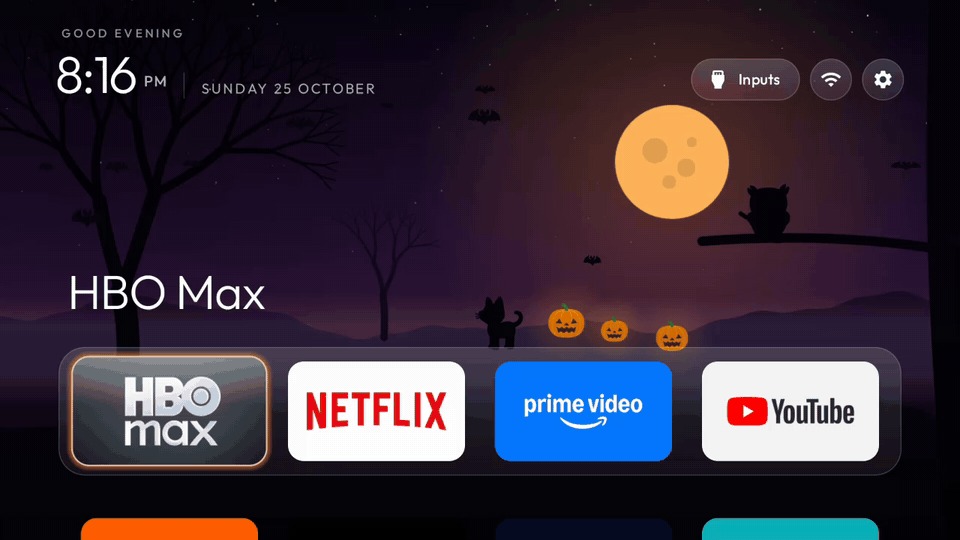

*October on a Xiaomi Mi TV P1, recorded from the TV. Not a mock-up.*

This is a branch of [cleanyourtv](https://github.com/Gathin23/cleanyourtv): everything in that
project stays as it is, and Temporadas adds three switches to its launcher and one theme that turns
them on. Without the theme, the launcher behaves exactly like the original.

[Español más abajo](#en-español)

## Twelve months

| | | | |
|---|---|---|---|
| 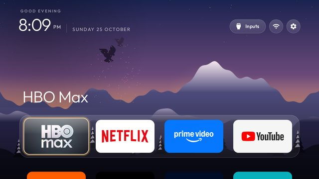<br>**January** · New Year<br>Eagles over snowy peaks at dawn, fireworks | 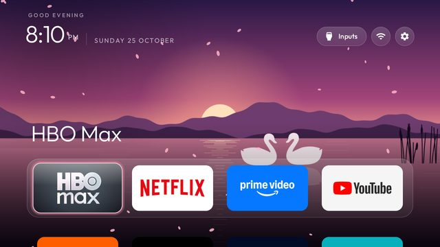<br>**February** · Love<br>Two swans facing each other on a lake at sunset, falling petals | 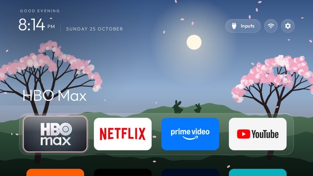<br>**March** · Spring<br>Rabbits hopping under cherry blossom | 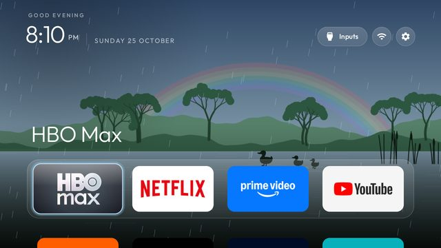<br>**April** · Rains<br>Ducks on a pond, a rainbow, light rain |
| 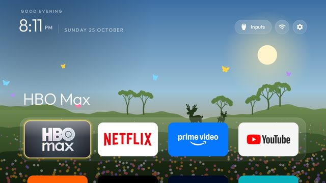<br>**May** · Flowers<br>Deer grazing in a meadow, butterflies | 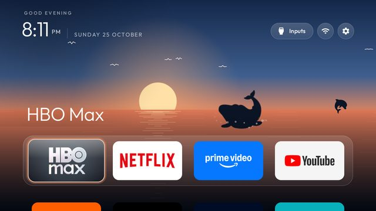<br>**June** · Ocean<br>A whale surfacing, dolphins leaping, gulls | 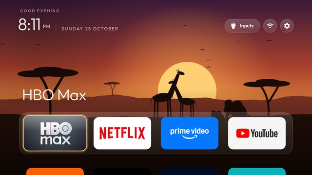<br>**July** · Safari<br>Giraffes and elephants under a huge sun | 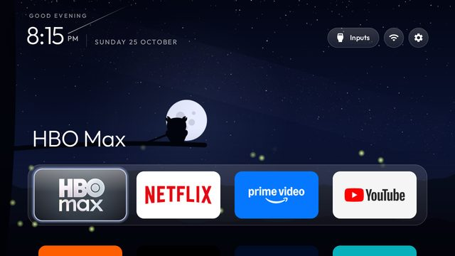<br>**August** · Starry night<br>An owl against the moon, shooting stars, fireflies |
| 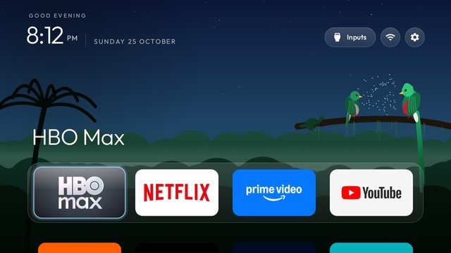<br>**September** · Independence<br>A pair of quetzals, Guatemala's national bird, fireworks in sky blue and white | <br>**October** · Halloween<br>Owl, black cat, glowing pumpkins, bats | 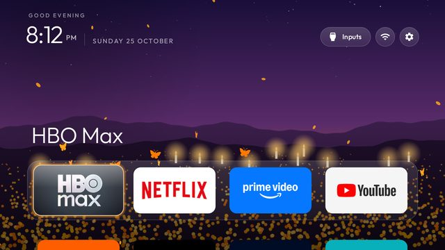<br>**November** · Día de Muertos<br>Monarch butterflies over marigolds, candles | 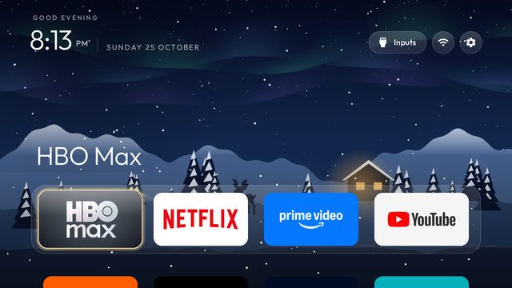<br>**December** · Christmas<br>Reindeer, a lit cabin, aurora, snowfall |

The launcher follows the calendar on its own and switches scene at midnight on the first of the
month. Nothing has to run on a computer or another device.

## When nobody is watching

**Home clears.** After three minutes without a key, the dock, the top buttons and the app name fade
away and leave the clock over the moving landscape. The first key brings them back, the dock's apps
rising one after another, and does nothing else: the focus stays where it was and nothing opens.

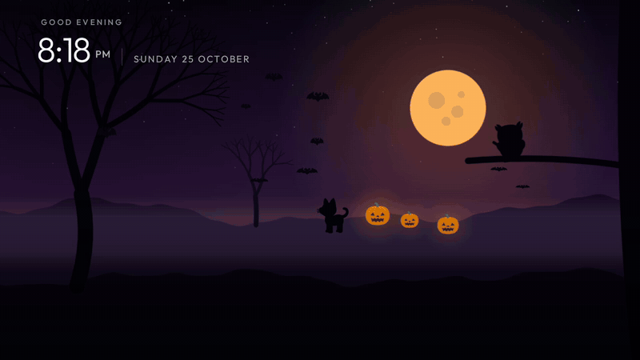

**The screensaver is the same scene.** The launcher's clock screensaver shows the month's landscape,
animals included, with a large clock that moves every minute. As the system screensaver it also
starts outside Home, after the TV has sat idle; a playing video keeps it away, as with any screensaver.

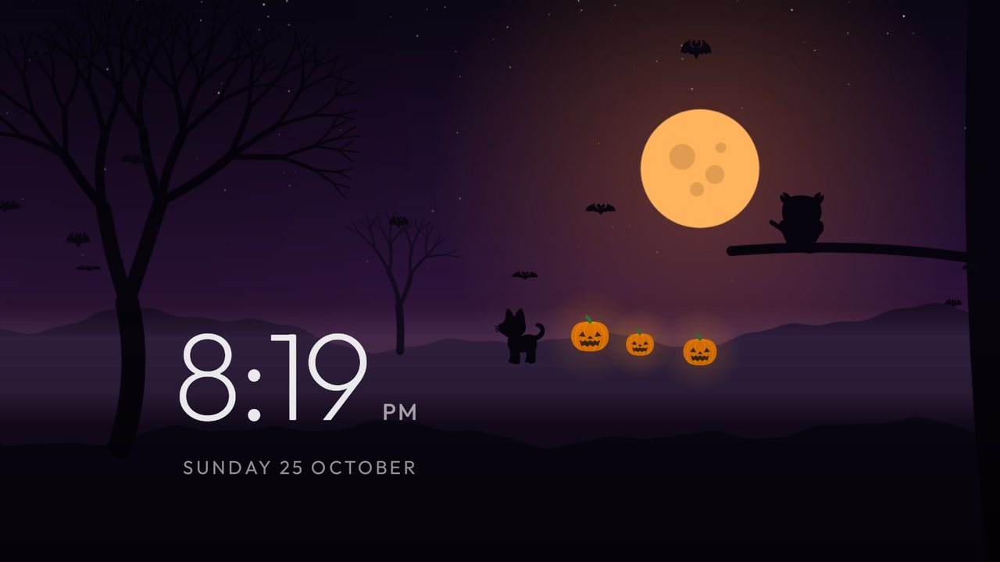

## Light by design

- **Drawn from code.** No photos, no downloads, nothing to license: the hills, trees and skies are
  sines and curves, the animals are system emoji painted as silhouettes. The quetzals are drawn by
  hand in code, because there is no quetzal emoji.
- **Only while you see it.** The landscape is drawn once a month into one 1280×720 picture, off the
  main thread. On top of it, only the animals and the weather move, about 30 frames a second, and
  only while Home or the screensaver is on screen. Behind an app it does nothing.
- **Measured on the TV:** about 12 % of one of the four cores while Home shows, and about 90 MB of
  memory for the whole launcher.
- **No new permissions, no network.** Like the original launcher, it has no `INTERNET` permission.
- **Calm on request.** With `reduced_motion` or `animations` off, the scene is a still picture.

## Install

You need what the [cleanyourtv Quick start](README.md) needs: a computer on the same network as the
TV, network debugging turned on in the TV's developer options, JDK 17 and the Android SDK.

```bash
git clone -b temporadas https://github.com/AlfaRojo/cleanyourtv.git
cd cleanyourtv
export TV_HOST=192.168.1.50          # your TV's IP address

launcher/build-and-install.sh        # builds the launcher and makes it Home
tools/theme.sh themes/temporadas     # turns Temporadas on
```

To use the scene as the screensaver after ten minutes:

```bash
python3 tools/tv.py 'settings put secure screensaver_components com.gathin.tvhome/.ClockDream'
python3 tools/tv.py 'settings put secure screensaver_enabled 1'
python3 tools/tv.py 'settings put system screen_off_timeout 600000'
```

Back to the plain launcher at any time with `tools/theme.sh --reset`. When you are done, turn network
debugging off again and check that the port is closed with `python3 tools/adb-closed.py <tv ip>`.

## Switches

`themes/temporadas/config.json` turns these on. They work in any theme, and all of them are off by
default.

| Key | Values | What it does |
|---|---|---|
| `season_scene` | `true` / `false` | The month's landscape and animals behind Home and the clock screensaver |
| `season_month` | `0` to `12` | Keep one month's scene (1 is January); `0` follows the calendar |
| `home_calm_minutes` | `0` to `1440` | Minutes without a key before Home clears; `0` never |

## Tested on

Xiaomi Mi TV P1 43" (MiTV-MOOQ2), Android TV 11, firmware RTM4.220307.164.8238. D-pad tested from
every edge of Home, the clear Home and its wake key, and the system screensaver.

Built by [AlfaRojo](https://github.com/AlfaRojo) on top of [cleanyourtv](https://github.com/Gathin23/cleanyourtv),
under the same [MIT licence](LICENSE). Issues and ideas: [AlfaRojo/cleanyourtv/issues](https://github.com/AlfaRojo/cleanyourtv/issues).

---

## En español

**Una pantalla de inicio para Android TV que vive el año.** Cada mes trae su propio paisaje,
dibujado con código, con animales que se mueven, y la fiesta del mes cuando la hay: Año Nuevo con
fuegos artificiales, Fiestas patrias con una pareja de quetzales (el ave nacional de Guatemala),
Halloween con búho, gato negro y murciélagos, Día de Muertos con cempasúchil y mariposas monarca,
Navidad con renos y nieve.

- El launcher cambia de escena solo, siguiendo el calendario.
- Después de tres minutos sin tocar el control, el inicio se despeja y queda el reloj sobre el
  paisaje. El primer botón trae de vuelta las apps, que suben una tras otra, sin abrir nada.
- El protector de pantalla muestra la misma escena con un reloj grande.
- Sin fotos, sin internet y sin permisos nuevos. Solo se anima mientras se ve el inicio o el
  protector.

**Instalación:** con la TV y la computadora en la misma red y la depuración por red activada en
la TV:

```bash
git clone -b temporadas https://github.com/AlfaRojo/cleanyourtv.git
cd cleanyourtv
export TV_HOST=192.168.1.50          # la IP de tu TV
launcher/build-and-install.sh
tools/theme.sh themes/temporadas
```

Para usarlo como protector de pantalla a los diez minutos, corre los tres comandos de
[Install](#install). Para volver al launcher normal: `tools/theme.sh --reset`. Al terminar, apaga
la depuración por red de la TV.
